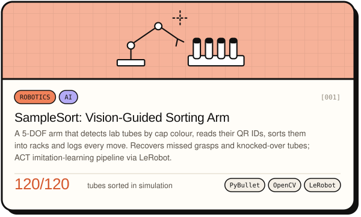
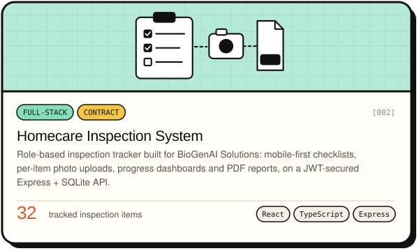
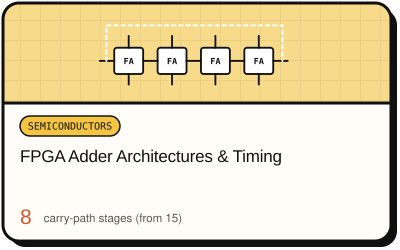
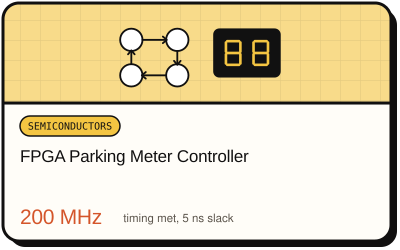
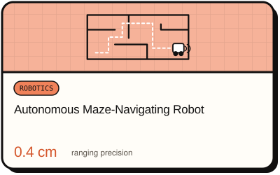
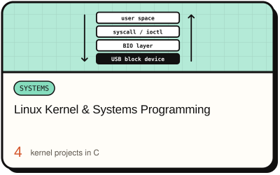
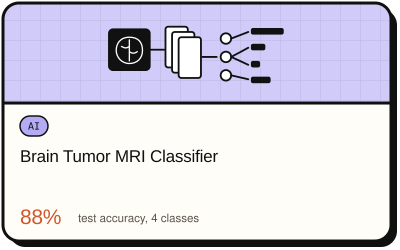
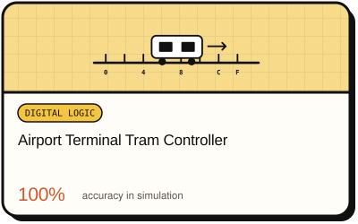

  &nbsp;
  &nbsp;
  &nbsp;
  

I'm a Computer Engineering junior at **Arizona State University** working where three things keep converging: **robotics**, **AI**, and **semiconductors**. In one semester I'll write structural Verilog for an FPGA, wire up a robot that finds its own way through a maze, and train a neural network, and I like that those are turning into the same job.

- 🔭 **Building:** [SampleSort](https://github.com/vignxhhh/SampleSort), a vision-guided arm that sorts lab samples
- 🌱 **Learning:** ROS 2 + MoveIt 2, embedded C on STM32, SystemVerilog verification
- 🎓 **On campus:** Technical Assistant @ Fulton Schools · Adobe & Autodesk Student Ambassador · Dean's List
- 🎯 **Looking for:** Summer 2027 internships and research in robotics, embedded AI, and AI / robotics silicon

## Featured work

  
  

## More from the lab

Coursework and side projects. Click a card for the code or the full write-up.

  
  
  
  
  
  

## Toolbox

<b>💼 Experience</b>

 

| Role | Where | When |
| --- | --- | --- |
| Design & Make Student Ambassador | Autodesk | Aug 2026 – now |
| Student Ambassador | Adobe | Jun 2026 – now |
| Technical Assistant | Ira A. Fulton Schools of Engineering, ASU | Feb 2026 – now |
| AI Application Engineer | BioGenAI Solutions LLC | May – Aug 2026 |
| Industry Officer | ACM at ASU | Nov 2025 – Aug 2026 |
| Technical Engineering Intern | American Chamber of Commerce, Abu Dhabi | May – Aug 2025 |

<b>🐧 Systems coursework highlights</b>

 

- **Custom Linux syscall** on a kernel compiled from source
- **Producer–consumer kernel module** on kernel threads and semaphores
- **Five-level page-table walker**
- **USB block device driver** exposing a USB drive through the BIO layer and IOCTL
- **Graph algorithms in C++ without the STL**, including Dijkstra's shortest path

<b>📜 Certifications</b>

 

**Semiconductors & hardware:** Intro to Semiconductor Manufacturing · Intro to VLSI · RTL Designing · Verilog Designing · FPGA Development · Embedded Systems with Rust 
**Robotics & vision:** Robotics and Mechatronics · Computer Vision with Ultralytics and OpenCV · Autonomous AI Systems 
**AI:** Claude API & AI Fluency (Anthropic) · LangChain and Hugging Face · AI Agents · Generative AI Concepts

<b>🎾 Off the keyboard</b>

 

13+ years on a tennis court, still playing with the ASU Tennis Club, and twice part of the support crew at the Mubadala World Tennis Championship in Abu Dhabi.

 

